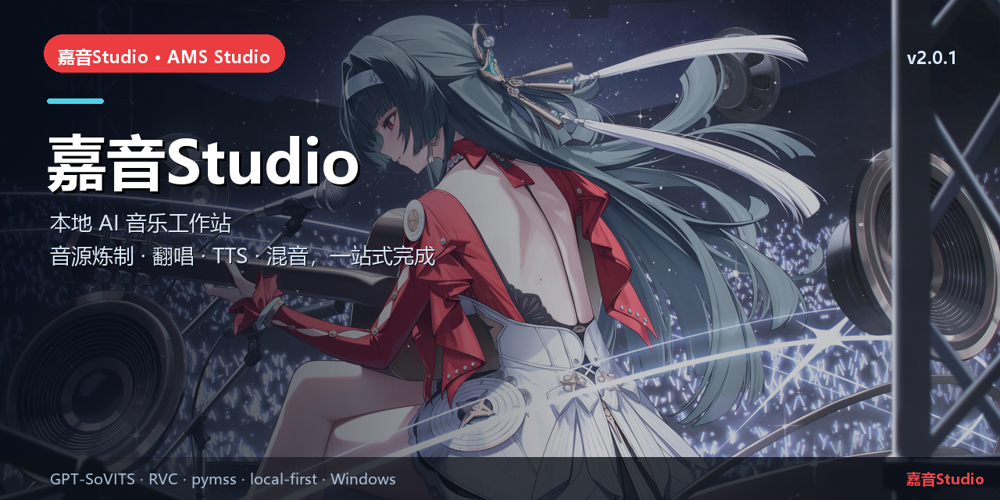

# 嘉音Studio（AMS Studio）

> 本地 AI 音乐工作站 · 一站式完成音源炼制、翻唱、TTS、分离、混音与评测

## 简介

嘉音Studio 是一个 **Windows 本地优先的 AI 音乐工作站**。启动器负责环境与组件，Kernel 提供 AI 工作区，
Gateway 调度 GPU 任务，插件提供音乐工作流页面，Agent 让你一句话完成从数据集到成品音频的处理。

当前发布：**v2.0.1**，feed sequence **2058**，默认 TTS 引擎为 **GPT-SoVITS V5turbo（48 kHz）**。

> 历史伞仓：本仓库是总入口与子模块索引；可交付源码以各子仓库 `main` 为准，最新发布资产在 [ams-release](https://github.com/yan-mc/ams-release/releases)。

## 核心能力

- **AI 一键处理**：Kernel 内“音乐制作”模式 + 22 个 `ams_*` 本地工具，先报告后执行。
- **自动格式适配**：导入音频自动统一采样率/声道，切片 3–10 秒，生成训练 metadata。
- **自动校验与微调**：任务完成自动评测时长、峰值、RMS、削波、静音；响度归一到目标 LUFS。
- **完整音乐链路**：RVC 音源炼制/换源、GPT-SoVITS TTS 炼制/合成、pymss 人声分离、混音母带、MSVC 转换。
- **本地与隐私**：数据留在安装目录 `data/`，Gateway 只监听 127.0.0.1，音频默认不上传。

## 本仓库

| 子仓库 | 作用 |
|---|---|
| [ams-launcher](https://github.com/yan-mc/ams-launcher) | Tauri 启动器 / 安装更新 / 环境检测 |
| [ams-harness](https://github.com/yan-mc/ams-harness) | 本地 AI 工作区内核（DSH fork） |
| [ams-services](https://github.com/yan-mc/ams-services) | FastAPI Gateway 与任务执行器 |
| [ams-plugins](https://github.com/yan-mc/ams-plugins) | 音乐工作台 UI / Cordis 插件 |
| [ams-agent-music](https://github.com/yan-mc/ams-agent-music) | 22 个工具的 AI 音乐 Agent + Skill |
| [ams-release](https://github.com/yan-mc/ams-release) | 签名 feed、安装包与发布资产 |
| [ams-docs](https://github.com/yan-mc/ams-docs) | 设计、验收、发布与交接文档 |
| [ams-tools](https://github.com/yan-mc/ams-tools) | 音频/格式转换工具链 |

## 快速开始

1. 从 [Latest Release](https://github.com/yan-mc/ams-release/releases/latest) 下载 Windows Setup。
2. 安装到有足够空间的磁盘（如 `F:\AMS-Studio`，不要装到 C: 用户目录）。
3. 启动器内检查组件 → 下载/安装 runtime 与默认音色。
4. 启动 Gateway → 启动 Kernel → 进入“AMS 音乐”工作台。
5. 新建会话，选择“音乐制作”，直接输入需求。

## 相关链接

- 总仓库：[yan-mc/AMS-Studio](https://github.com/yan-mc/AMS-Studio)
- 最新发布：[yan-mc/ams-release releases](https://github.com/yan-mc/ams-release/releases)
- 当前版本：**嘉音Studio v2.0.1**（feed 2058）
- 文档：[ams-docs](https://github.com/yan-mc/ams-docs)

## 说明

- 所有音乐数据默认留在安装目录 `data/`；Gateway 只监听 `127.0.0.1`。
- 本项目为本地优先工具，不提供云端上传；使用第三方模型/音频时请遵守各自许可。
- License: MIT (see `LICENSE`).
